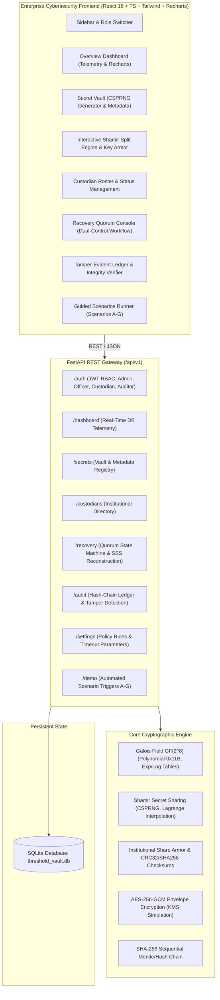
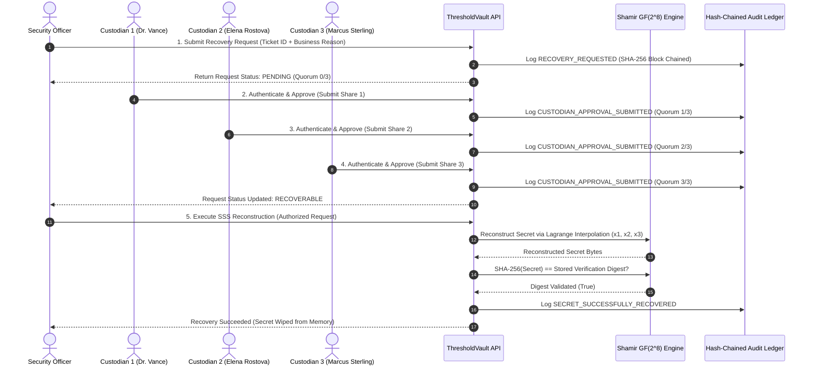

# ThresholdVault: Institutional Cryptographic Key Custody and Recovery

> **Academic Prototype & Demonstration System**  
> *Threshold Secret Sharing Based Key Custody for Institutions*  
> **Notice**: This project is an institutional research prototype using synthetic demonstration keys and simulated roles. It is designed for educational, verification, and architecture demonstration purposes and is not certified for production high-value root custody without HSM integration.

---

## 1. Abstract & Executive Summary

Financial institutions, sovereign wealth custodians, certificate authorities, and digital asset consortiums face a fundamental dilemma in cryptographic key custody: single-custodian storage introduces a catastrophic single point of failure (theft, extortion, or loss), while standard data duplication multiplies exposure.

**ThresholdVault** demonstrates a mathematically robust solution using **Shamir's Secret Sharing (SSS)** over the finite field $\text{GF}(2^8)$ (the AES Rijndael field). A master cryptographic secret (e.g., an HSM partition root key, CA private key, or validator cold seed) is divided into $n$ distinct polynomial shares such that any $k$-sized threshold subset can reconstruct the exact original secret, whereas any coalition of $k-1$ or fewer shares gains strictly zero information. Combined with a multi-party recovery workflow, role-based access control (RBAC), encryption-at-rest for share persistence, and a tamper-evident SHA-256 hash-chained audit ledger, ThresholdVault provides institutional governance over high-value key custody.

---

## 2. System Architecture



### Institutional Multi-Party Recovery Sequence



---

## 3. Technology Stack

- **Frontend**:
  - React 18, TypeScript, Vite 5
  - Tailwind CSS 3 (Dark Navy cybersecurity theme `#070A12`, `#0B0F19`, `#141D33`)
  - Recharts 2 (Custody policy distribution donut & recovery trend charts)
  - Lucide React (Enterprise security iconography)
  - Custom Toast & Persona Switcher Context
- **Backend**:
  - Python 3.13 & FastAPI (Asynchronous REST API, OpenAPI docs at `/docs`)
  - Pydantic v2 (Strict request/response validation & serialization)
  - SQLAlchemy 2 & SQLite (`threshold_vault.db`)
  - Python-Jose (JWT session authentication & RBAC)
  - Cryptography (AES-256-GCM for share persistence simulation)
  - Pytest & HTTPX (18 automated tests)

---

## 4. Mathematical Cryptography Engine

### Galois Field $\text{GF}(2^8)$ Arithmetic
Standard Shamir implementations that operate over large primes $\mathbb{Z}_p$ suffer from message truncation, arbitrary length padding, or leakage of the upper bound $p$. ThresholdVault implements Shamir Secret Sharing byte-by-byte over the finite field $\text{GF}(2^8)$ defined by the irreducible AES Rijndael polynomial:

$$P(x) = x^8 + x^4 + x^3 + x + 1 \quad (0\text{x}11\text{B})$$

- **Addition and Subtraction**: Evaluated as bitwise XOR ($\oplus$):
  $$a \oplus b = (a \oplus b) \pmod 2$$
- **Multiplication**: Evaluated using primitive generator $\alpha = 3$ with precomputed $\exp$ and $\log$ lookup tables for constant-time $O(1)$ operations:
  $$a \otimes b = \exp((\log(a) + \log(b)) \pmod{255})$$
- **Division / Inversion**:
  $$a / b = \exp((\log(a) - \log(b) + 255) \pmod{255})$$

### Polynomial Generation and Splitting
For a secret byte array $S$ of length $L$, for each byte position $j \in \{0, \dots, L-1\}$, a random polynomial of degree $k-1$ is constructed:

$$f_j(x) = S_j \oplus \bigoplus_{m=1}^{k-1} a_{j,m} \cdot x^m$$

where $a_{j,m} \in \text{GF}(2^8)$ are sampled using cryptographically secure pseudorandom number generators (`secrets.randbelow(256)`). The constant term $f_j(0) = S_j$ is the secret byte.

Share $i$ evaluates each polynomial at distinct custodian coordinate $x_i \in \{1, 2, \dots, n\}$.

### Lagrange Basis Interpolation
Given any subset of $k$ distinct shares $\{(x_1, y_1), \dots, (x_k, y_k)\}$, the original secret byte is recovered by evaluating the Lagrange polynomial at $x = 0$:

$$S_j = \bigoplus_{i=1}^k y_{i,j} \otimes L_i(0)$$

where the Lagrange basis polynomial evaluated at 0 is:

$$L_i(0) = \bigotimes_{m \ne i} \frac{x_m}{x_i \oplus x_m}$$

### Institutional Share Armoring & Verification
Shares are serialized in institutional armored format with CRC32 integrity checksums:
```
TVSHR:v1:<share_id>:<secret_id>:<x>:<threshold>:<total_shares>:<payload_hex>:<checksum_hex>
```

---

## 5. Threshold Key Custody vs. Threshold Signing (MPC / TSS)

It is critical to distinguish between **Threshold Secret Sharing (SSS)** and **Threshold Signatures (MPC / TSS)**:

| Dimension | Shamir Secret Sharing (SSS) (This Application) | Threshold Signature Schemes (TSS / FROST / MPC) |
| :--- | :--- | :--- |
| **Recovery Phase** | Reconstructs the complete master secret into memory. | The master private key is **never** reconstructed. |
| **Operational Goal** | Cold backup, disaster recovery, HSM key escrow. | Active transaction signing, continuous signing quorums. |
| **Communication** | Simple share collection (single round). | Interactive multi-round cryptographic commitment rounds. |
| **Risk Window** | Ephemeral risk during the brief reconstruction instant. | Requires sustained network liveness between signers. |

ThresholdVault is designed specifically for **Institutional Disaster Recovery & Escrow**: recovering root partition keys when HSM hardware fails or catastrophic operational events occur.

---

## 6. Pre-Configured Demo Accounts & Roles

The system comes pre-seeded with 8 institutional identities covering the complete RBAC matrix:

| Persona | Role | Email | Password | Department |
| :--- | :--- | :--- | :--- | :--- |
| **Chief Information Security Officer** | `ADMIN` | `admin@thresholdvault.io` | `Admin@Vault2026!` | Executive Directorate |
| **Sarah Lin (Lead Cryptographer)** | `SECURITY_OFFICER` | `officer@thresholdvault.io` | `Officer@Vault2026!` | Cryptographic Key Custody |
| **Dr. Aris Vance** | `CUSTODIAN` | `custodian1@thresholdvault.io` | `Custodian@123` | Treasury Operations |
| **Elena Rostova** | `CUSTODIAN` | `custodian2@thresholdvault.io` | `Custodian@123` | Core Infrastructure |
| **Marcus Sterling** | `CUSTODIAN` | `custodian3@thresholdvault.io` | `Custodian@123` | Risk & Governance |
| **Devon Thorne** | `CUSTODIAN` | `custodian4@thresholdvault.io` | `Custodian@123` | Cloud Security |
| **Amina Patel** | `CUSTODIAN` | `custodian5@thresholdvault.io` | `Custodian@123` | Legal & Compliance |
| **Victor Thorne** | `AUDITOR` | `auditor@thresholdvault.io` | `Auditor@Vault2026!` | Independent Audit |

> [!TIP]
> Use the **Role Switcher** in the top navigation bar to switch between any persona with 1-click for seamless demonstration.

---

## 7. Guided Demonstration Scenarios (A through G)

ThresholdVault includes an interactive demonstration runner accessible from the top navbar or sidebar:

- **Scenario A (Successful 3-of-5 Recovery)**: Generates 5 shares and demonstrates that both subsets $\{1, 2, 3\}$ and $\{1, 2, 5\}$ reconstruct the original secret and match the SHA-256 verification hash.
- **Scenario B (Insufficient Shares Rejection)**: Submits only 2 shares for a 3-of-5 secret; mathematically rejected with `InsufficientSharesError`.
- **Scenario C (RBAC Authorization)**: Demonstrates that Auditor or non-officer accounts are rejected with `HTTP 403 Forbidden` if attempting to initiate recovery.
- **Scenario D (Corrupted Share Detection)**: Aligns a bit-flip corruption in the payload hex; rejected by CRC32 checksum before interpolation.
- **Scenario E (Multi-Party Approval Workflow)**: Simulates 3 independent custodians casting signed votes to advance a request from `PENDING` to `RECOVERABLE`.
- **Scenario F (Zero Secret Leakage)**: Proves that auditors can inspect every log entry, metadata row, and telemetry point without seeing secret values.
- **Scenario G (Tamper-Evident Hash Chain Detection)**: Deliberately alters a past database record without updating the hash, then executes sequential verification to detect the breach.

---

## 8. Installation & Execution Instructions

### Prerequisites
- Python 3.11+ (Python 3.13 recommended)
- Node.js v18+ or v20+ and npm

### Backend Setup
```bash
cd ThresholdVault/backend

# 1. Install dependencies
pip install -r requirements.txt

# 2. Seed development database (auto-creates threshold_vault.db)
python -m app.seed

# 3. Run automated test suite
python -m pytest tests/ -v

# 4. Start the FastAPI backend server
python -m uvicorn app.main:app --host 127.0.0.1 --port 8000 --reload
```
API Documentation will be live at: `http://127.0.0.1:8000/docs`

### Frontend Setup
In a separate terminal:
```bash
cd ThresholdVault/frontend

# 1. Install dependencies
npm install

# 2. Verify clean production build
npm run build

# 3. Start Vite development server
npm run dev
```
Open your browser at: `http://localhost:5173`

---

## 9. Security Assumptions & Threat Model

1. **Information-Theoretic Confidentiality**: As long as fewer than $k$ custodians collude, the plaintext secret cannot be derived.
2. **Encryption-at-Rest Simulation**: Custodian shares are encrypted using AES-256-GCM under a separate master storage key, simulating envelope encryption in an HSM.
3. **Audit Immutability**: Each audit log block is linked sequentially via SHA-256. Tampering with any log entry or payload invalidates all subsequent block signatures.
4. **Zero Plaintext Persistence**: Plaintext secrets are never written to database tables or application logs. Only a SHA-256 verification digest is stored for integrity checks.

---

## 10. Verification Results Summary

- **Backend Pytest Suite**: 18 tests passed (100% pass rate) covering:
  - `test_gf256_basic_arithmetic`
  - `test_shamir_split_and_reconstruct_3_of_5`
  - `test_shamir_insufficient_shares`
  - `test_shamir_duplicate_shares_rejected`
  - `test_shamir_incompatible_shares_rejected`
  - `test_invalid_policy_parameters`
  - `test_share_formatting_and_checksum_verification`
  - `test_login_success_and_jwt`
  - `test_login_invalid_password`
  - `test_rbac_custodian_cannot_register_secret`
  - `test_rbac_auditor_cannot_initiate_recovery`
  - `test_unauthenticated_request_rejected`
  - `test_full_recovery_lifecycle`
  - `test_audit_chain_initial_integrity`
  - `test_tamper_detection_in_hash_chain`
  - `test_no_secret_leakage_in_metadata_api`
  - `test_shares_encrypted_at_rest_in_database`
  - `test_no_credential_or_key_leakage_in_audit_logs`
- **Frontend TypeScript / Vite Build**: Clean build, 0 errors, production assets emitted in `dist/`.
